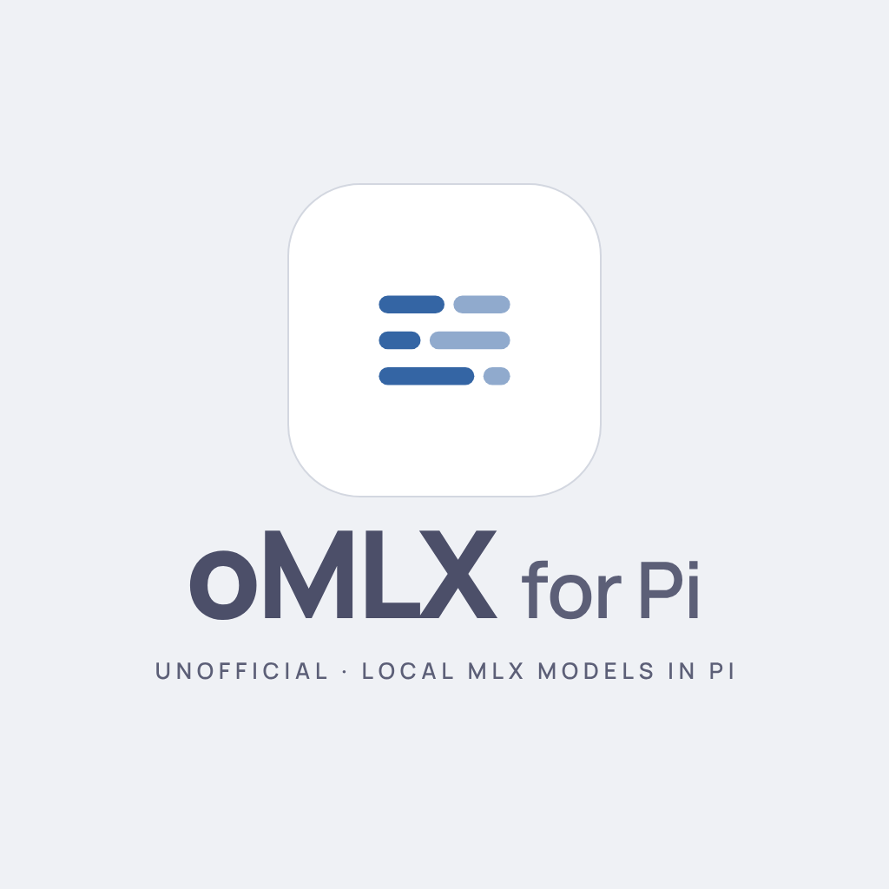

<div align="center">
  
  <br>
  <a href="https://www.npmjs.com/package/@jmcombs/pi-omlx"></a>
  <a href="https://www.npmjs.com/package/@jmcombs/pi-omlx"></a>
  <a href="https://opensource.org/licenses/MIT"></a>
  <a href="https://github.com/jmcombs/pi-extensions/stargazers"></a>
  <a href="https://github.com/jmcombs/pi-extensions/issues"></a>
  <a href="https://github.com/sponsors/jmcombs"></a>
</div>

# @jmcombs/pi-omlx

> omlx provider for Pi: run local MLX models through omlx with the same experience as Pi's llama.cpp provider.

**MLX models only.** omlx has limited GGUF support, but this extension does not work with GGUF. GGUF is not supported. If you need GGUF, use Pi's built-in llama.cpp provider.

This extension is unofficial and is not affiliated with or endorsed by oMLX.

## Quick start

```bash
pi install npm:@jmcombs/pi-omlx
```

Then, in Pi:

```text
/login omlx
/omlx
/model
```

`/login omlx` asks for the server URL, then a required API key. The default URL is `http://127.0.0.1:8000`. A blank key is not stored.

Without `/login`, point Pi at the server with `OMLX_BASE_URL` and `OMLX_API_KEY`. A stored URL wins over `OMLX_BASE_URL`. When no key is stored, Pi uses `OMLX_API_KEY`, then the placeholder `local` for a keyless server.

See the [Pi packages documentation](https://pi.dev/docs/packages) for git, local path, project-scoped install, and filtering options.

To try this checkout without installing:

```bash
pi -e ./packages/omlx
```

## What it adds

- **Provider** `omlx` — local MLX chat through an omlx server, with the same experience as Pi's llama.cpp provider.
- **Command** `/omlx` — list, load, unload, and download models. Interactive mode only.
- **`/model`** — lists loaded MLX chat models. Load one with `/omlx` before selecting it.
- **Classifiers** — loaded chat models and decision models are `typesafe-system-one` classifiers. Decision models are classifiers only; they do not appear in `/model`.

## Differences from Pi's llama.cpp provider

- **Generic post-login message.** After `/login omlx`, Pi shows its generic post-login message. It does not tell you to load a model. Run `/omlx`, then `/model`.
- **No `-builtin` switch.** External packages cannot use `-builtin:`. Remove this package to disable it; `-builtin:omlx` does not apply.
- **No sleeping models.** omlx has no sleeping status. Sleeping models do not appear, and nothing wakes on use.
- **Chat can evict.** A chat request can evict an LRU model. Pi's llama.cpp provider does not unload other models during chat.
- **Keep loaded is best-effort.** Selecting an unloaded model while others are loaded still offers `Unload all and load`, `Keep loaded and load`, and `Cancel`. Keep loaded is honored only when memory fits. When it does not, omlx can evict an LRU non-pinned model to admit the load.
- **Stop loading only stops waiting.** Esc during a load still asks `Stop loading?`. There is no load-cancel route. Confirming it only stops waiting; the server finishes the load in the background.
- **No GGUF exact entry.** `owner/repo` downloads an MLX repo. A GGUF repo, or any `:quant` suffix, is rejected. This extension supports MLX models only. GGUF is not supported.
- **No quantization picker.** Each MLX repo is already one quantization, so there is no picker and no GGUF quant list.
- **Downloads need the main API key.** omlx downloads are admin routes. A sub key fails. Use the server's main API key.

## Configuration

| Name            | Role                                                                   |
| --------------- | ---------------------------------------------------------------------- |
| `/login omlx`   | Store the server URL and API key. Default URL `http://127.0.0.1:8000`. |
| `OMLX_BASE_URL` | Server root when no URL is stored.                                     |
| `OMLX_API_KEY`  | API key when none is stored.                                           |
| `/omlx`         | Load, unload, and download MLX models.                                 |
| `/model`        | Select a loaded MLX chat model.                                        |
| Classifiers     | Loaded chat models and decision models, via `typesafe-system-one`.     |

Downloads through `/omlx` need the main API key, not a sub key.

## Requirements

- Pi `>= 1.4.0`
- Node `>= 22.19.0`
- A local omlx server. The default URL is `http://127.0.0.1:8000`.

## Development

This package lives in the [pi-extensions monorepo](https://github.com/jmcombs/pi-extensions).
See `CONTRIBUTING.md` at the repo root for project conventions.

Use Pi APIs everywhere. Do not reinvent a way of integrating with Pi that falls outside the
APIs Pi provides. If a needed capability has no Pi API, stop and escalate it to the human. Do
not assume, and do not build a workaround on your own.

```bash
# From the repo root
npm ci
npm run check
```

Testing this package against omlx requires a live omlx server. Do not stand in a
local HTTP server. This requirement is only for `packages/omlx`; other packages
do not need a live omlx server.

```bash
OMLX_LIVE=1 OMLX_BASE_URL=http://127.0.0.1:8000 OMLX_API_KEY=... OMLX_TEST_MODEL=... \
  npx vitest run packages/omlx/live.test.ts
```

## License

[MIT](./LICENSE) © Jeremy Combs
